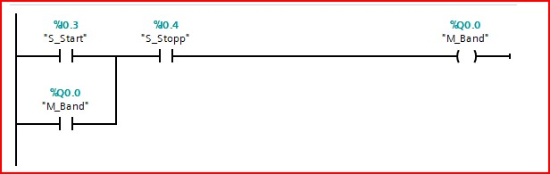
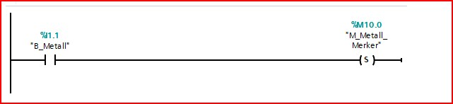
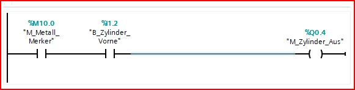
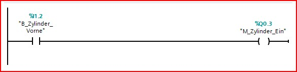
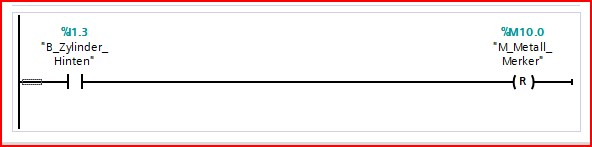
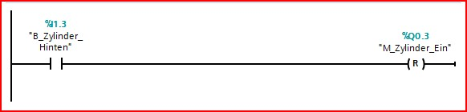
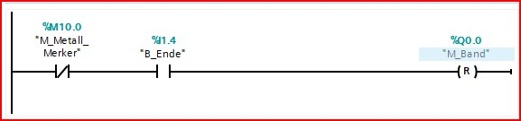
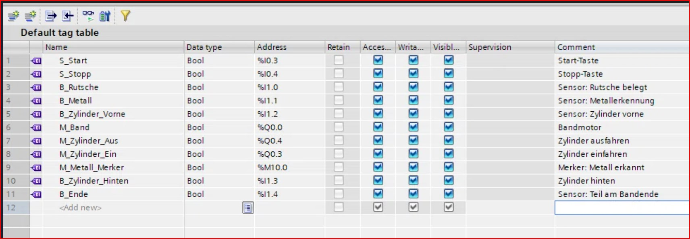
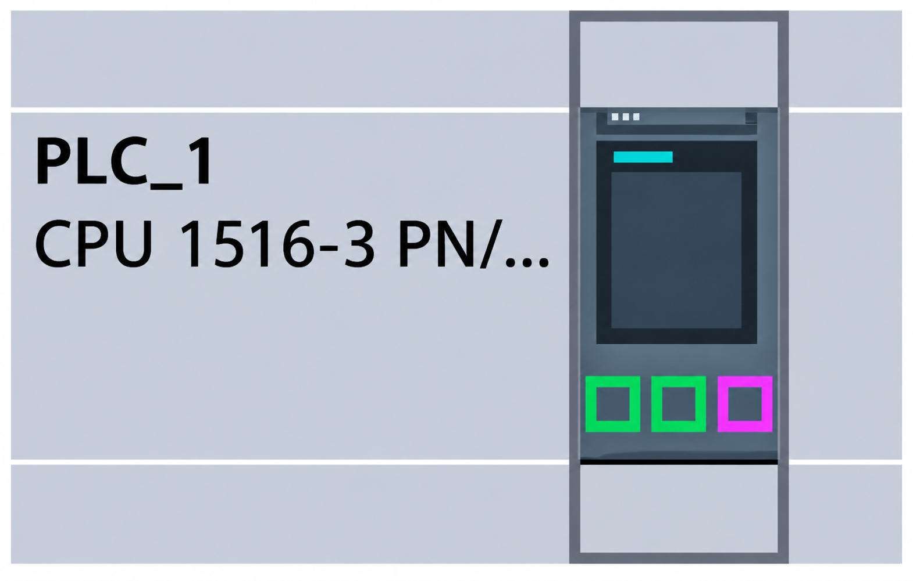
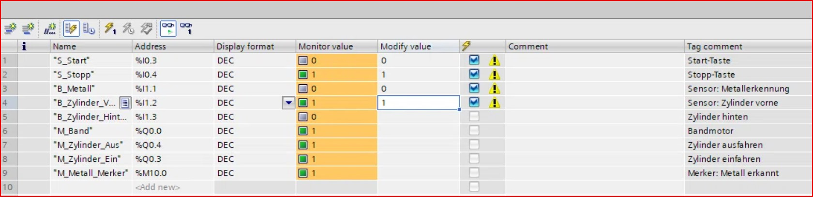

# Projekt: Sortieranlage (Metall/Kunststoff)

## Kurzbeschreibung
Dieses Projekt realisiert eine automatisierte Sortieranlage für Metall- und Kunststoffbauteile in TIA Portal. Die Anlage erkennt Metallteile über einen induktiven Sensor und schiebt sie mit einem Zylinder in ein Magazin. Kunststoffteile werden bis zum Bandende transportiert und dort aussortiert.

## Dokumentation
Eine vollständige Projektdokumentation (inkl. Tests und Erklärungen) wird in Kürze als PDF hinzugefügt.

## Verwendete Hardware / Software
* **Software:** TIA Portal V19 (Trial), S7-PLCSIM V19
* **Steuerung:** SIMATIC S7-1500 (CPU 1516-3 PN/DP)
* **Sprache:** LAD (Kontaktplan)

## Screenshots der Logik (Main [OB1])

### 1. Bandsteuerung mit Selbsthaltung
Die Start-Taste (S_Start) schaltet das Band (M_Band) ein. Ein paralleler Kontakt (M_Band) sorgt für die Selbsthaltung. Die Stopp-Taste (S_Stopp) unterbricht den Stromkreis.

### 2. Metallerkennung (Merker setzen)
Wenn der induktive Sensor (B_Metall) ein Metallteil erkennt, wird der Merker (M_Metall_Merker) mit einer Set-Katze (S) gesetzt.

### 3. Zylinder ausfahren
Wenn der Merker (M_Metall_Merker) gesetzt ist UND das Teil den Sensor vor dem Zylinder (B_Zylinder_Vorne) erreicht hat, fährt der Zylinder aus (M_Zylinder_Aus).

### 4. Zylinder einfahren
Sobald der Zylinder die vordere Endlage (B_Zylinder_Vorne) erreicht hat, wird die Steuerung für das Einfahren (M_Zylinder_Ein) aktiviert.

### 5. Merker zurücksetzen
Wenn der Zylinder wieder in der hinteren Endlage (B_Zylinder_Hinten) ist, wird der Merker (M_Metall_Merker) mit einer Reset-Katze (R) zurückgesetzt.

### 6. Zylinder-Stopp
Um ein dauerhaftes Ansteuern des Zylinders zu verhindern, wird der Einfahr-Befehl (M_Zylinder_Ein) zurückgesetzt, sobald die hintere Endlage (B_Zylinder_Hinten) erreicht ist.

### 7. Bandstopp für Kunststoffteile
Wenn der Merker NICHT gesetzt ist (also ein Kunststoffteil) UND das Teil den Sensor am Bandende (B_Ende) erreicht hat, wird das Band (M_Band) mit einer Reset-Katze (R) gestoppt.

## Variablen-Tabelle & Hardware

## Tests & Verifikation
Die Logik wurde in S7-PLCSIM V19 erfolgreich getestet.

### Test 1: Metallteil
Das Metallteil wird erkannt, der Merker gesetzt und der Zylinder fährt aus.

### Test 2: Kunststoffteil
Das Kunststoffteil wird nicht als Metall erkannt (Merker = 0). Am Bandende stoppt das Band.

## Autor
Yevhen Samoilenko